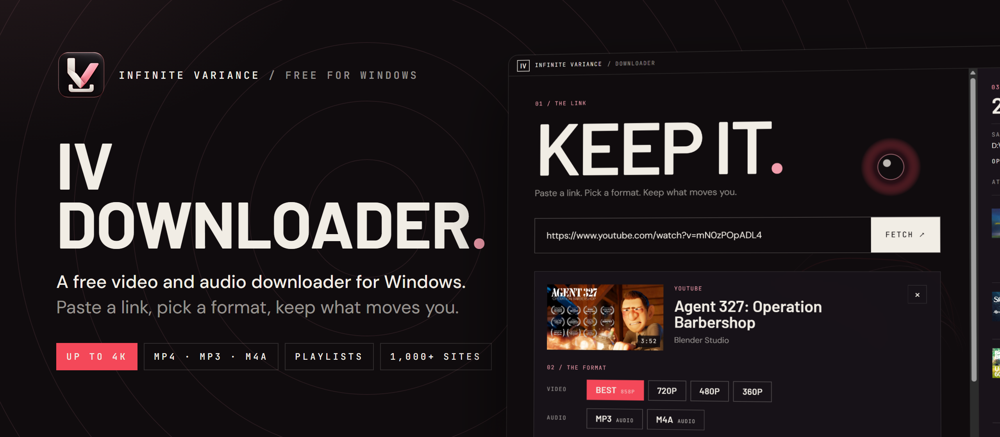
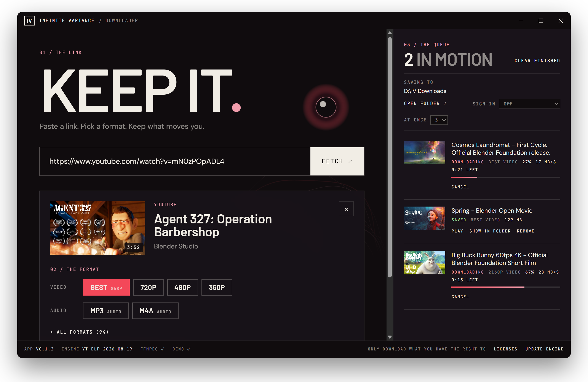
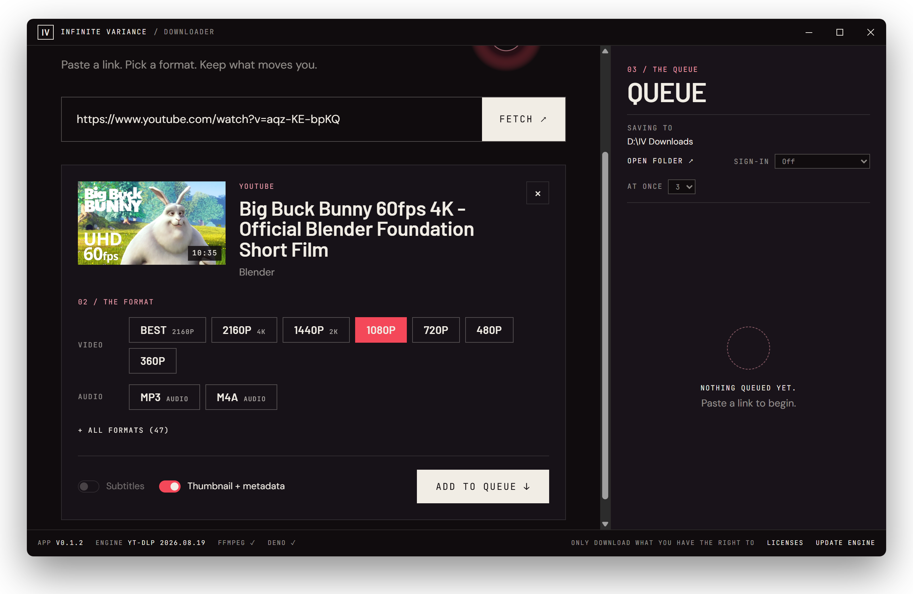
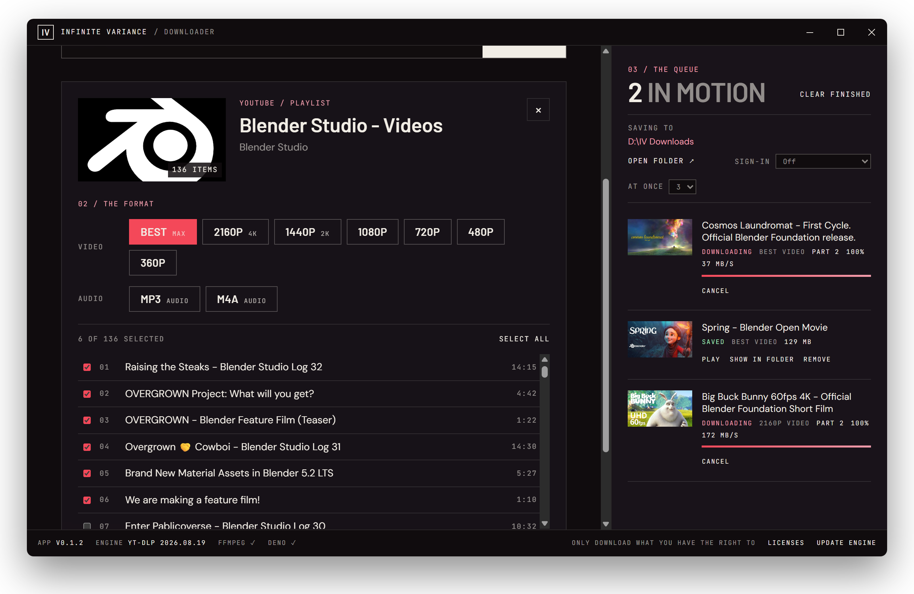

<p align="center">
  
</p>

<p align="center">
  <a href="https://github.com/hollisorg/iv-downloader/releases/latest/download/IV-Downloader-Setup.exe"><b>Download for Windows</b></a>
  &nbsp;·&nbsp;
  <a href="https://github.com/hollisorg/iv-downloader/releases/latest">Release notes</a>
  &nbsp;·&nbsp;
  <a href="https://infinitevariance.ai">Infinite Variance</a>
</p>

# IV Downloader

A free Infinite Variance desktop app for saving video and audio from YouTube, Vimeo, X, TikTok,
Instagram and the [1,000+ other sites](https://github.com/yt-dlp/yt-dlp/blob/master/supportedsites.md)
that [yt-dlp](https://github.com/yt-dlp/yt-dlp) supports. Paste a link, pick a format, keep it.

<p align="center">
  
</p>

## Features

- **Paste a link.** Fetch reads the title, thumbnail and every available format without downloading
  anything. A link already on your clipboard is offered as a one-click chip.
- **Pick a format.** Best, 2160p (4K) down to 360p (only the sizes the video actually has), MP3 or M4A
  audio, or any raw stream under *All formats*. Video presets prefer H.264 MP4, so files drop
  straight into Premiere and other editors. Toggles embed subtitles, the thumbnail and metadata.
- **Whole playlists and channels.** Tick the videos you want and queue them all in one go.
- **A real queue.** Run 1–5 downloads at once with live progress, speed and time left. Cancel, retry,
  play or show in folder. The queue is saved and picks up where it left off after a restart.
- **Private and members-only videos.** Optional sign-in through Firefox, Chrome, Edge, Brave, Opera,
  Vivaldi or a `cookies.txt` file. Cookies are read locally by yt-dlp and never stored or sent
  anywhere by the app.
- **Always current.** The yt-dlp engine is downloaded from its official release and checked against
  its published checksums. **Update engine** keeps it current when sites change, and the app updates
  itself from GitHub Releases.

<table>
  <tr>
    <td width="50%"></td>
    <td width="50%"></td>
  </tr>
  <tr>
    <td align="center"><sub>Choose the quality, or just the audio</sub></td>
    <td align="center"><sub>Queue a whole playlist or channel</sub></td>
  </tr>
</table>

## Install

1. [Download `IV-Downloader-Setup.exe`](https://github.com/hollisorg/iv-downloader/releases/latest/download/IV-Downloader-Setup.exe)
   (Windows 10 or 11, 64-bit, about 200 MB).
2. Run it. The installer isn't code-signed yet, so Windows may show **"Windows protected your PC"**.
   Click **More info → Run anyway**.
3. It installs for your user only, with no admin rights needed, and adds Start menu and desktop shortcuts.
   Downloads go to `Downloads\IV Downloads` unless you pick another folder.

On first launch the app fetches the latest `yt-dlp.exe` (about 18 MB) and keeps it in
`%APPDATA%\IV Downloader\bin`.

Only download what you have the right to download.

## Not supported

DRM-protected streaming services (Netflix, Prime Video, Disney+, Spotify and similar). IV Downloader
does not decrypt or strip DRM, and won't.

---

## For developers

```bash
npm install
npm run dev
```

### Build the installer

```bash
npm run dist
```

This writes `dist\IV-Downloader-Setup.exe`, a per-user NSIS installer. ffmpeg, ffprobe and Deno are
unpacked next to `app.asar`; yt-dlp is fetched on first run. The installer is about 210 MB, mostly
ffmpeg, ffprobe and Deno. Releases are built and uploaded by GitHub Actions when a version tag is
pushed; see [docs/RELEASING.md](docs/RELEASING.md). Signing is covered in
[docs/CODE-SIGNING.md](docs/CODE-SIGNING.md).

### Layout

```
src/main/engine.js    yt-dlp install/verify/update, bundled ffmpeg+ffprobe and deno paths, process runner
src/main/probe.js     link metadata (yt-dlp -J --flat-playlist)
src/main/formats.js   picker choice -> yt-dlp arguments (built only in the main process)
src/main/queue.js     download queue, progress parsing, cancel (kills ffmpeg too), save/resume
src/main/updater.js   app self-update from GitHub Releases
src/main/index.js     window, settings (incl. sign-in), IPC
src/preload/index.js  window.iv API exposed to the UI
src/renderer/src/     React UI (Infinite Variance palette: ink, paper, pink, red; Barlow, DM Sans, JetBrains Mono)
build/                app icon and bundled licence texts
docs/images/          README screenshots
```

The renderer is sandboxed with context isolation and never builds command lines. It sends a format
choice, and the main process turns that choice into yt-dlp arguments. URLs must be http(s) and are
passed after `--`.

### Still to do

- Code signing (Azure Artifact Signing; see [docs/CODE-SIGNING.md](docs/CODE-SIGNING.md)).
- macOS and Linux builds.

## Licence

IV Downloader is MIT-licensed (see [LICENSE](LICENSE)). Bundled third-party tools keep their own
licences; see `THIRD_PARTY_NOTICES.txt`, also available from **Licenses** in the app's status bar. The
bundled FFmpeg build is GPLv3, and the notices link its exact source.

Screenshots show [Blender Studio](https://studio.blender.org/) open movies (CC BY).
